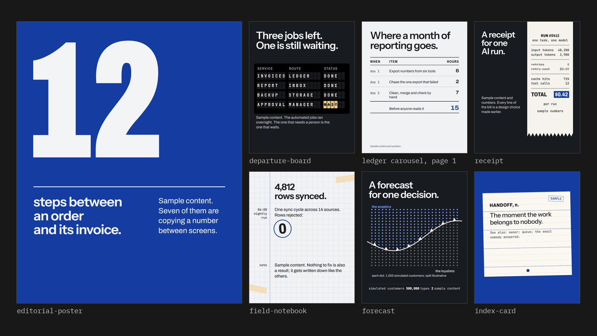
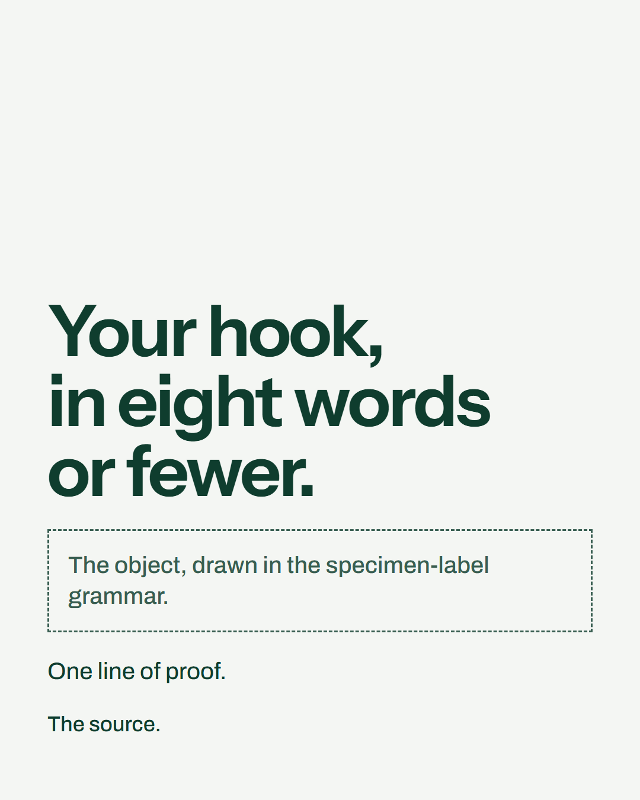
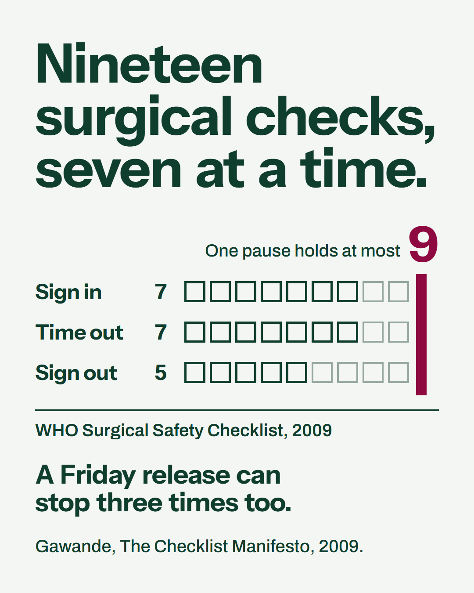
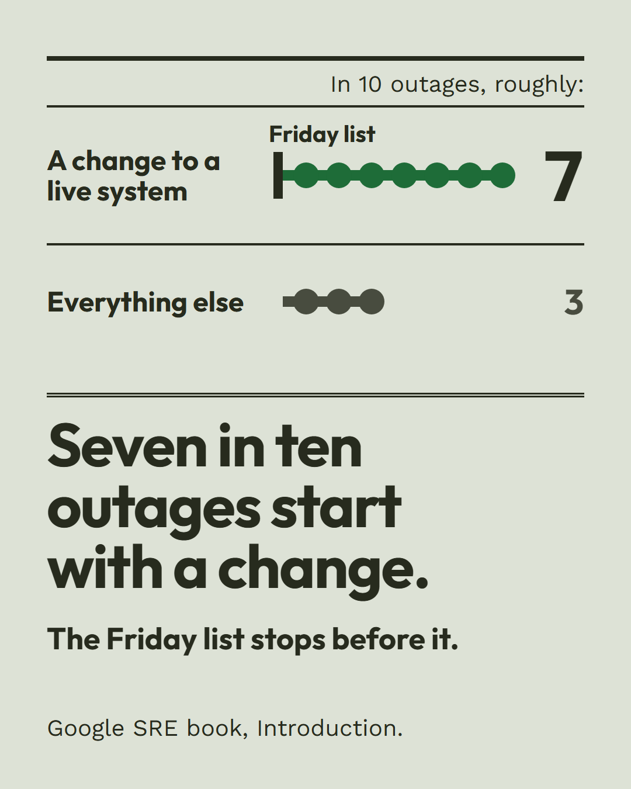
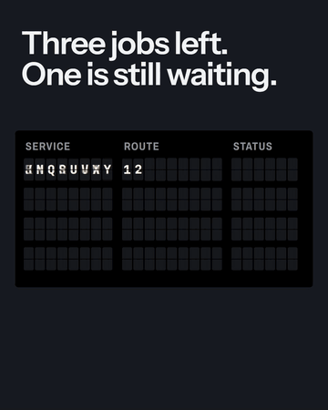
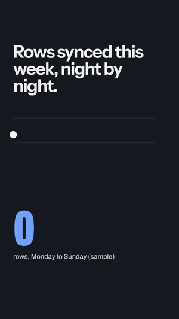

# Atelier

Claude designs your social images, carousels, slides and short videos, renders them on your machine, and checks them before you post.

[](https://github.com/goofypluto999/atelier/actions/workflows/check.yml) [](LICENSE)

Atelier is a Claude Code plugin. It builds each piece in HTML, renders it to PNG, PDF or MP4, and measures the result with scripts (type size, contrast, overflow, safe zones) before a critic agent that did not make it reviews it. It remembers what you made, so the next piece takes a different layout, colour plan and angle, within your brand's hues. For people who publish designed posts on LinkedIn, Instagram and similar feeds.

Made by [The Mansions Agency](https://themansions.agency).



Seven covers on dark, paper and ultramarine grounds, all with sample content: six of the bundled art directions and page 1 of the ledger example. All 19 specimens (17 art directions, a 16:9 slide and a 9:16 story) on one sheet: [directions.png](plugins/mansions/skills/atelier/assets/directions/directions.png).

## Quick start (one image)

You need Claude Code, Node 20 or newer (Playwright 1.63.0 stops below 20) and Python 3.10 or newer (`python3` on macOS and Linux, where the commands below say `python`).

**1. Install the plugin.** In Claude Code:
```
/plugin marketplace add goofypluto999/atelier
/plugin install atelier@mansions
```

**2. Install the render tools** in the project folder where you want the image:
```
# bash or zsh
npm i -D playwright@1.63.0
npx playwright install chromium
# Windows PowerShell: npm and npx start .ps1 files, which its default execution policy stops; the .cmd forms run
npm.cmd i -D playwright@1.63.0
npx.cmd playwright install chromium
```
Then Pillow, in a virtual environment: Python on recent Debian, Ubuntu and Homebrew refuses a bare `pip install` into the system Python (PEP 668).
```
# bash or zsh
python3 -m venv .venv                  # Git Bash on Windows: python -m venv .venv
. .venv/bin/activate                   # Git Bash on Windows: . .venv/Scripts/activate
pip install -U "pillow>=10.3"
# PowerShell (no Activate.ps1: the default execution policy blocks it)
python -m venv .venv
.venv\Scripts\python -m pip install -U "pillow>=10.3"
```
In bash or zsh, activate it again in each new terminal before you run the scripts. In PowerShell, type `.venv\Scripts\python` where the lines below say `python`; the commands compose.py prints then use that Python too. On Linux, install Chromium's system libraries too, as CI does: `npx playwright install --with-deps chromium`.

**3. Ask Claude:** `Use Atelier to make one image about [your topic]. Use only these facts: [facts, with sources].` Or run `/atelier:atelier`. Claude runs the steps below for you.

Words used here: atoms are sourced facts; an angle is your one-line take; the genome is the dealt design (direction, colours, type, layout); lenses are points of view; play operators are ways to turn facts into an angle; dealt means picked at random, weighted away from what you made before.

**4. Or run the steps yourself.** Set `S` to the skill folder. The plugin cache keeps it under a folder named for the installed version, so these lines take the highest version number (1.10.0 after 1.9.0):
```
# bash or zsh
S=$(ls -d "${CLAUDE_CONFIG_DIR:-$HOME/.claude}"/plugins/cache/mansions/atelier/*/skills/atelier | sort -V | tail -n 1)
# PowerShell
$C = if ($env:CLAUDE_CONFIG_DIR) { $env:CLAUDE_CONFIG_DIR } else { "$HOME/.claude" }
$S = (Get-ChildItem "$C/plugins/cache/mansions/atelier" -Directory | Sort-Object { [version]$_.Name } | Select-Object -Last 1).FullName + "/skills/atelier"
```
Claude Code keeps its plugin cache in its config folder: `~/.claude`, or the folder `CLAUDE_CONFIG_DIR` names when it is set. Both lines above look there first.

Start a piece, then ask for the next step:
```
python "$S/scripts/compose.py" new first-image --topic "your topic" --scope quick --medium image
python "$S/scripts/compose.py" next first-image
```
`next` prints the one next command, with your absolute paths and the Python that ran compose.py, quoted. Each line runs as printed in the shell you ran compose.py from: in PowerShell on Windows it starts with `& `, and in Git Bash (it sets `MSYSTEM`), bash and zsh it does not. Its first answer looks like this (paths shortened to `<project>` and `<S>`, the Python to `python`):
```
atoms: fill <project>/.atelier/pieces/first-image/01-atoms.md. Then grade it (the notes template is at the end of the worksheet):
  python <S>/scripts/compose.py grade first-image atoms --scores "coverage=,specificity=,sourced=,surprise=" --notes <notes.md> --by self
```
The rest of the path, one command per step. Run `next` at any point to see where you are.

1. Write 3 to 5 facts with their sources in `01-atoms.md`, then run the grade line above with your scores and a notes file.
2. `python "$S/scripts/compose.py" deal first-image angles`: pick one of the 3 dealt operators (ways in, such as "ask the sceptic"), write one angle (your one-line take) with it, grade it, then record it with `choose`.
3. `python "$S/scripts/compose.py" deal first-image genome`: grade the dealt design. Then run `next`: it prints the `palette.py` line first. Run that line; it writes `palette.css`, your colour plan.
4. `python "$S/scripts/compose.py" scaffold first-image` (the line `next` prints after that): it writes `visual.html`, a composition start in the dealt direction, type and palette, not a copy of the direction's specimen. Build the direction's device out of your own object; the stock parts to leave out and the logo rules are in [SKILL.md](plugins/mansions/skills/atelier/SKILL.md), quick path step 5. Keep the page to 45 words and the hook to 8.
5. `node "$S/scripts/render.mjs" visual.html --audit`: fix every FAIL it prints, and cut to the word budget it states.
6. `python "$S/scripts/attention.py" .`: fix a FAIL on what the eye sees first.
7. Write the post text that goes out with the image (`post.md`, with every claim on the page in it). Give `page-01.png`, the post text and the slug `first-image` to the `atelier:art-director` agent, save its verdict to a file, and run the visual grade line `next` prints.
8. `python "$S/scripts/compose.py" deliver first-image`: Atelier remembers the piece, so the next one is dealt away from it, and adds its cover to the layout memory.

What each check refuses: [Rules the checks enforce](#rules-the-checks-enforce).

## What one run looks like

One real run on 30 Oct 2026 of the quick path above, on the topic "what a Friday release checklist really needs", in an empty folder with one made-up brand file. Every verdict came from a fresh art-director agent.
Two of three pieces passed, each at exactly the bar of 7.5. With the brand file, the piece failed at 7.2 and passed at 7.5 on its second attempt. Without it, the piece failed at 6.0, 6.5 and 6.3 and went to a person: the critics read its 7-in-10 drawing as a chart any statistic could fill. A third piece, pinned to the warm register, failed at 6.7 and 6.8 and passed at 7.5 on its third attempt.
After each FAIL, `next` named the best attempt so far, its verdict's fixes and its keep line, and the next attempt started from it.
The step log, every verdict, audit, render, post text and piece.json: [docs/run](docs/run/README.md).

A fourth piece, run on 30 and 31 Oct 2026 after drawn films joined the video path, was a 10 s film on the same topic: one ticket of 19 checks on a kitchen rail, cut into tickets of 7, 7 and 5 that are ticked off and stamped. Each verdict came from a fresh Sonnet agent (the model of each call is in its evidence), and each judged the film alive. It failed all three attempts (6.0 with craft capped, 7.0 and 6.7) and went to a person: the last critic found the cut that carries the idea at the film's least readable moment, stamps over a row of checks, and placeholder lines on the tickets. Its verdicts, contact sheets, script output, pages and last video are in [docs/run](docs/run/README.md).

| Start: what scaffold wrote for piece 1 | Piece 1 (PASS 7.5) | Piece 2, best attempt (FAIL 6.5) | Piece 3, warm register (PASS 7.5) |
|---|---|---|---|
|  |  |  |  |

## How it works

1. **Atoms.** The topic is broken into atoms: facts, numbers, objects, roles and tensions, each with a source. Ideas start from atoms, not from the headline.
2. **Lenses and play operators.** Three points of view are dealt from 24 lenses (the auditor, the newcomer, the object itself), and up to six play operators from 44 (reverse it, zoom in on one number, borrow a genre), taken from lateral thinking, TRIZ, SCAMPER, bisociation and constrained writing. Each operator turns the atoms into one candidate angle.
3. **The genome.** Every design decision for the piece is dealt together: format (30), art direction (28), register, meaning the feeling (9), hook, close, colour harmony and arc, type pairing, motion and layout rhythm.
4. **Memory.** It is built not to repeat itself: compose.py remembers delivered pieces in your project's `.atelier/` folder and deals the next one away from them. Each value is weighted down by its recent uses, and a new genome must differ from each of the last 10 pieces on a minimum number of axes that rises as memory grows. The same topic twice gets no operator, lens, format or direction it had before ([docs/composer-demo.md](docs/composer-demo.md), [tests/test_composer.py](plugins/mansions/skills/atelier/tests/test_composer.py)). [tests/test_diversity.py](plugins/mansions/skills/atelier/tests/test_diversity.py) simulates 30 pieces by default (20 in CI) and fails if any two within a window of 10 differ on fewer than 3 axes.
5. **Grades.** Eight stages (atoms, lenses, angles, genome, sections, copy, visual, final) each have a rubric and a threshold. A grade needs a reason per criterion. compose.py checks that each reason is 25 characters or more, not that it quotes or locates evidence. Below the threshold the stage is recreated (with a fresh deal where it was dealt) or revised. After 3 graded attempts (2 for the final stage) it goes to a person. The angles, sections, copy, visual and final stages are graded by a critic agent, with its verdict file as evidence (in quick scope, only the visual stage).
6. **Checks.** The scripts measure the rendered pages, not the prompt. Then a critic agent that did not make the piece reviews the PNGs. Three ship with the plugin: `atelier:story-editor` (angles and structure), `atelier:art-director` (the rendered pages) and `atelier:copy-critic` (the words), plus the `humanizer` skill for long copy.

The full pipeline is in [SKILL.md](plugins/mansions/skills/atelier/SKILL.md). The composer is explained in [references/composer.md](plugins/mansions/skills/atelier/references/composer.md).

## Rules the checks enforce

- **The audit** (`render.mjs --audit`) writes `page-NN.png` and `audit.json`. It exits 1 on a hard rule:
  - text under 32 px (36 px for condensed faces, 22 px for labelled fine print), measured as drawn after SVG and CSS transforms;
  - contrast under 4.5:1 for text under 48 px (3:1 above), in any CSS colour form (`color-mix()` and relative colours too), judged on the rendered pixels over a gradient, a picture or a drawn film;
  - text off the page or over other text;
  - a rule or border running through text;
  - text in platform UI zones;
  - a hook that is not the biggest type;
  - a broken link, a missing image or a fallback font.

  A film is checked at more than its first frame: every hard rule but the hook rule runs again every half second of the film (at 0.5 s, 1 s, 1.5 s and on to its end) and at the poster time. The length comes from `--seconds N` (pass the same `--seconds` and `--poster` as to `motion.mjs`), else from `ART.film`, else from the CSS animations. With no known length, only the first frame is checked, and the audit says so.

  It warns, without failing, on:
  - AI-look tells, and shapes painted over text;
  - accent paint over 5% of the page;
  - display type that leaves one word alone on its last line or ends a line on a small word;
  - more than 45 words on a page (it says how many to cut).

  Seven more warnings name what the art-director charged in the 30 Oct 2026 runs. Fix them before a critic sees the page:
  - `phone read`: text under 36 px, or under 40 px in a weight under 500, fine print included (the page line gives the smallest size with fine print);
  - `claim twice`: a line that repeats the hook's words;
  - `wrapped run`: identical marks that wrap and leave a short last row;
  - `hairline accent`: an accent mark drawn under 8 px;
  - `empty cell`: a cell mostly empty beside a full one;
  - `faint mark`: a mark with no text (an empty slot, a dot, an outline) under 3:1 against the ground behind it (WCAG 1.4.11). A small shape in the mark's own colour, such as the line under a dot, or a shape smaller than the mark is not its ground; `data-allow="faint"` marks decoration;
  - `thin stroke`: display type, 48 px or more, whose strokes are under 6 px (2 px on a phone) and under 6.5% of its size, as script, hairline and light faces draw.
- **The first glance** (`attention.py`): page 1 must be led by the hook, the number or the object. A logo, or an element without a `data-role`, never leads (FAIL). An accent may lead by under 1.5 times the best hook, number or object, which prints a note; by more, it fails. Body and fine text are left out of this race. A logo under 3:1 against its ground fails.
- **The critic's scores.** The art-director scores six criteria (idea, hook, hierarchy, craft, colour, distinct; idea and hook weigh 1.5) and ends its verdict with a `verdict:` line and a `scores:` line. With nothing in memory, it judges distinct against the shipped specimens and the clusters in [references/tells.md](plugins/mansions/skills/atelier/references/tells.md). Type the critic's scores into `--scores`; compose.py refuses numbers that differ from the verdict file and recomputes the total. A verdict that says FAIL or REVISE never passes. compose.py checks the verdict's form, scores and binding, not who wrote it.
- **The visual grade is bound to its piece.** The render must be in the folder scaffold wrote the page in, or in a `--folder` that holds this piece's own `visual.html`, with `page-NN.png` and a PASS `audit.json` newer than `visual.html`. The verdict's `## <slug>` heading must be this piece's slug, and a verdict file already used by another piece is refused. Every grade records the sha256 of the verdict file; a passing grade also records the sha256 of `visual.html` and every page.
- **Attempts.** A stage goes to a person after 3 graded attempts (2 for the final stage). A FAIL verdict never passes and counts as an attempt. Each visual attempt is kept with its page, renders and verdict in `.atelier/pieces/<slug>/attempts/visual-<n>`, and after a FAIL `next` names the best attempt so far, its verdict's numbered fixes and its `keep:` line: the next attempt starts from that one.
- **The start page.** For an image or a carousel, `scaffold` writes a composition start (the grid, the dealt type and colours, each page set up for its dealt layout word), never the direction's specimen, and the deal never gives page 1 the specimen's own layout. The genome and visual worksheets list the specimen's stock parts, which must not appear unchanged. Quick scope deals only directions that have a specimen, so there is always a picture of the grammar to read. In full and design scope, a direction without a specimen gives a plain start, and scaffold says so.

## What the scripts check

All scripts are in [plugins/mansions/skills/atelier/scripts](plugins/mansions/skills/atelier/scripts). A check that fails exits non-zero.

| Script | What it does |
|---|---|
| `compose.py new\|next\|deal\|choose\|grade\|adopt\|similar\|status\|scaffold\|deliver\|coverage` | The composer. `next` prints the one next step, with absolute script paths. `<command> --help` explains each command. A slug uses lower case letters, digits, dots, dashes and underscores. `new <slug> --brand <tokens.css>` passes your brand to the palette line. `deal <slug> genome [--pin axis=value]` deals one direction inside the genome, and its worksheet says what the dealt hook and close mean and what to compose. `scaffold <slug> [--out visual.html]` writes a composition start for it, not the direction's specimen. `grade` on a critic-graded stage needs `--evidence <critic verdict file>`: type the critic's scores into `--scores`; compose.py refuses numbers that differ from the verdict file and recomputes the total. `deliver` writes the memory, `.atelier/history.jsonl`, and adds the cover to the layout memory. In design scope (inside another system) it says to deliver only after the host approves. |
| `render.mjs <file> [--audit] [--png] [--pdf] [--video scenes.json] [--no-png] [--out <dir>] [--size WxH] [--safe reels\|story] [--raw-max N] [--seconds N] [--poster T]` | HTML pages to PNG and PDF (with no flag it writes both; `--png` or `--pdf` writes one; `--video` makes an MP4 from a scenes file; `--raw-max` sets how many raw colours a page may keep, default 6). `--audit` also writes the PNGs (`--no-png` skips them) and fails on the hard rules above. It warns, without failing, on AI-look tells, among them fake product chrome (window dots, live dots, NEW or BETA badges), pill tags and too many corner radii, panels nested three deep, and raw colour values outside the tokens. It also warns when the page's `--accent` covers 5% or more of the page (text left out), when display type leaves a word alone or ends a line on a small word, when a page carries more than 45 words, and on the seven warnings above. It fails a rule or border that runs through text. It deletes stale page PNGs above the new page count. |
| `attention.py <folder>` | A simplified Itti, Koch and Niebur saliency model: a prediction of what the eye lands on first, by each element's share of the page. Fails on the first-glance rules above. Exit 2 when the folder has no page PNGs. |
| `palette.py --register <r> --harmony <h> --arc <a> --pages <n> [--ground dark\|paper\|field] [--field-page N]` | The colour plan in OKLCH. Keeps the brand's hues; without `--brand` it makes the piece its own palette from the register, harmony and arc, kept off the specimens' colours. Says when the register overrides the harmony, warns when the colours sit near a cluster that generated design falls into, and checks contrast and colour vision on every page. Writes `palette.css`. `--taste <id>` starts from one of 56 curated palettes. |
| `cvd.py <folder>` | Protan, deutan and tritan simulation. Ends with `cvd: PASS` or `cvd: WARN` (an accent that differs from its ground by hue only). |
| `contact_sheet.py <folder> [--out <file>]` | Every page on one sheet, for the critic. |
| `layout_memory.py check\|add <cover>` | Fails a cover that copies the shape of one of the last 8 (kept in `.atelier/covers`). |
| `motion.mjs <file> --seconds 20 [--sub 2] [--out <dir>]` | Frame-exact MP4 from `window.seek(t)`, with poster, first frame and SRT captions. A drawn film with a camera, springs and a film finish uses `ART.film` from `assets/lib/art-motion.js` ([references/art-motion.md](plugins/mansions/skills/atelier/references/art-motion.md)). The page may load local files only: any other request is blocked and the render fails. Needs ffmpeg. |
| `video_check.py <folder>` | Duration, dead beats (looked for on a quarter-size, blurred copy, so film grain does not hide one), black frames, caption timing, contact and phone sheets. |
| `copy_lint.py <file>` | Cringe, preachy, salesy, samey and AI-sounding copy, and flat sentence rhythm. It warns on repeated words. |
| `brand_extract.mjs <url>` | A draft brand file (colours, type, logos, contrast) from a live site. |
| `get_font.py "<Family>"` | An open-licensed Google font with its licence, into your project. |
| `specimens.mjs [id ...]` | Renders page 1 of each direction specimen with the bundled `tokens.css`, and overwrites `assets/directions/specimens/*.png` and `directions.png` in the skill folder (in a plugin install, in the plugin cache). It has no brand option. |
| `calibrate.py prepare\|score` | Tests a critic blind against known answers. |
| [`vendor/huashu-design/scripts/design_lint.py`](plugins/mansions/skills/atelier/vendor/huashu-design/scripts/design_lint.py) `check\|ledger` | huashu-design's checker for template habits and repeated looks. Optional: it needs `pip install playwright==1.63.0` (the same version as the Node one), which the quick start does not install. |

## Examples

| Carousel, 6 pages | Motion, 4:5 | Reel, 9:16 |
|---|---|---|
|  |  |  |

Sources: [examples/ledger-carousel](plugins/mansions/skills/atelier/examples/ledger-carousel), [departure-board.motion.html](plugins/mansions/skills/atelier/assets/directions/departure-board.motion.html), [examples/the-dot-reel](plugins/mansions/skills/atelier/examples/the-dot-reel). All content in them is sample content.

## Use your brand

Copy [assets/brands/TEMPLATE.css](plugins/mansions/skills/atelier/assets/brands/TEMPLATE.css), or start from `brand_extract.mjs <your site>`. Fill in the roles (grounds, text, one accent, faces). Start each piece with `compose.py new <slug> --brand <your file>.css`: the colour plan keeps your hues, and `scaffold` links your file after [tokens.css](plugins/mansions/skills/atelier/assets/tokens.css). If your file declares `--disp`, `--body` or `--mono`, scaffold keeps those faces; the dealt type pairing sets only the ones it leaves out. Without `--brand`, a paper ground is never dealt a serif display face (cream paper with a serif is a look generated design falls into).

The default look is generic: tokens.css holds a neutral palette that belongs to no brand, and the specimens are drawn in it. A piece made without `--brand` does not wear it: `palette.py` makes that piece its own paper, ink and accent from the dealt register, harmony and arc, kept at least 0.04 OKLab (grounds and text) and 0.10 (accents) from the specimens' colours and out of the generated-design colour clusters ([references/colour.md](plugins/mansions/skills/atelier/references/colour.md), "Own palette"). The Mansions Agency palette and logo are an optional theme, [assets/themes/mansions.css](plugins/mansions/skills/atelier/assets/themes/mansions.css): load it after tokens.css, or pass it with `--brand`. The specimens carry an empty logo slot: `scaffold` fills it from your brand file's `--logo` (`--logo-on-dark` on a dark or colour-field ground), or removes it and says why. The Mansions logo is a trademark and not licensed to you: use it only for work by or for The Mansions Agency. If you copy a specimen page by hand, put your own logo in its empty slot.

## Other ways to install

- **Without the plugin system:** copy [plugins/mansions/skills/atelier](plugins/mansions/skills/atelier) to `~/.claude/skills/atelier`, [plugins/mansions/skills/humanizer](plugins/mansions/skills/humanizer) to `~/.claude/skills/humanizer`, and the files in [plugins/mansions/agents](plugins/mansions/agents) to `~/.claude/agents/`. The agents are then named `art-director`, `story-editor` and `copy-critic`, and `S` is `~/.claude/skills/atelier`.
- **Claude.ai or the Claude desktop chat:** download `atelier-skill.zip` and `humanizer-skill.zip` from the [latest release](https://github.com/goofypluto999/atelier/releases/latest). In Claude, go to Customize, Skills, click the + button, then Create skill, then Upload a skill, and pick the zip ([Anthropic's steps](https://support.claude.com/en/articles/12512180-use-skills-in-claude); code execution must be on under Settings, Capabilities). The atelier zip holds the skill folder with its LICENSE and CREDITS.md. It leaves out `tests/`, `evals/` and the rendered video, PDF and sheets of the two examples, which makes it about 6.76 MB (a zip of the whole folder is 9.10 MB; both built with `git archive` as in [CONTRIBUTING.md](CONTRIBUTING.md), measured 31 Oct 2026). It does not hold the three critic agents, and the rendering and checks need Node, Playwright and Python with Pillow 10.3 or newer on your own machine; without them the skill gives design guidance and critique only.

## What it costs

- **Always in context:** about 366 tokens, the count `claude plugin details` shows for the installed plugin (in Windows PowerShell, `claude.cmd plugin details` when Claude Code came from npm, whose `claude.ps1` the default execution policy stops) (30 Oct 2026). The descriptions of the 2 skills and 3 agents are 1,394 characters of the committed files.
- **When the skill loads:** SKILL.md is 18,776 characters, about 4,700 tokens at 4 characters per token, counted on the committed file (`git show HEAD:<path>`, 31 Oct 2026), not on a Windows working copy, whose line ends add a character per line. That is an estimate, not a tokenizer count. The humanizer skill's SKILL.md is 32,309 characters, about 8,100 tokens by the same estimate. References load only when a step needs them.
- **Critic calls:** each graded critic stage is one Sonnet agent call (`model: sonnet` in the three files in [plugins/mansions/agents](plugins/mansions/agents)). A quick image grades only the visual stage, so it takes 1 to 3 calls: one per attempt, and a stage goes to a person after 3. In the full pipeline the angles, sections, copy, visual and final stages each take a critic call.
- No script calls a paid service.

## Are the critics tested?

[evals/anchors](plugins/mansions/skills/atelier/evals/anchors) (10 covers: 3 strong, 7 with one planted flaw) and [evals/angles](plugins/mansions/skills/atelier/evals/angles) (8 angles: 3 strong, 5 flawed) are the calibration sets. The anchors log holds two runs, on 29 and 30 Oct 2026; the angles log holds one, on 29 Oct. The 29 Oct runs came before the art-director and [references/critique.md](plugins/mansions/skills/atelier/references/critique.md) changed on 30 Oct: every flaw caught, every strong item passed. Their verdict files were not kept. Run `calibrate.py` yourself before you trust a critic.

Calibration after the 30 Oct changes: the art-director ran again blind and shuffled on Sonnet on 30 Oct 2026, caught 7 of 7 flawed covers and passed 3 of 3 strong ones. Its verdicts and the answer map are in [evals/anchors/runs/2026-10-30](plugins/mansions/skills/atelier/evals/anchors/runs/2026-10-30).

## Layout
```
.claude-plugin/marketplace.json        the marketplace ("mansions")
plugins/mansions/.claude-plugin/       the plugin manifest ("atelier")
plugins/mansions/agents/               story-editor, art-director, copy-critic
plugins/mansions/skills/humanizer/     the humanizer skill (blader, MIT)
plugins/mansions/skills/atelier/
  SKILL.md                             the quick path, the full pipeline and the hard rules
  LICENSE, CREDITS.md                  copies of the root files, so every install carries them
  references/                          process, brief, directions, composition, type, colour, carousel,
                                       motion, art-motion, film-styles, dataviz, copy, imagery, tells, critique, science,
                                       brand, composer
  scripts/                             the tools above
  data/                                operators, lenses, formats, registers, colour, rubrics, directions,
                                       type pairings, structures (hooks, closes, layout words)
  vendor/                              the source projects' tools and references, pinned and licensed (MANIFEST.md),
                                       among them huashu-art-motion's five drawing files
  tests/                               composer, diversity, palette, motion and reading-time tests; fixtures with planted flaws
  assets/                              tokens.css (neutral), themes/ (optional Mansions theme), brands/, fonts/ (OFL),
                                       lib/motion.js, lib/art-motion.js (drawn films), directions/ (specimens)
  examples/                            ledger-carousel (6 pages), the-dot-reel (9:16)
  evals/                               anchors and angles: calibration sets with known answers
docs/                                  the images in this README, the composer demo, the worked runs (run/) and
                                       the tool-adoption process (INTAKE.md)
.github/workflows/check.yml            CI: validates the plugin, audits every specimen, runs the tests
```
CI fails if the audit, the copy lint, the attention check or design_lint stops catching one of the original planted flaws. CI also runs `tests/test_readcheck.py`, the reading-time check's planted faults. The newer fixtures, `tests/test_palette.py` and `tests/test_motion.py` run from the local list in [CONTRIBUTING.md](CONTRIBUTING.md), where each line prints its exit code next to the expected one.

## Credits

Atelier builds on ideas and vendored files from taste-skill, huashu-design, huashu-art-motion, lemo-opuscar, brag, superpowers, humanizer, Uncodixfy, Anthropic's frontend-design and canvas-design skills, and two community motion-design sources (the awesome-opus5-5-videos list and Ray C.'s motion design studio guide), and on the author's own design notes. Each is listed with its author and licence in [CREDITS.md](CREDITS.md); the vendored files and their commits are in [vendor/MANIFEST.md](plugins/mansions/skills/atelier/vendor/MANIFEST.md). The design theory and research it cites are graded in [references/science.md](plugins/mansions/skills/atelier/references/science.md). A third-party tool comes in only through [docs/INTAKE.md](docs/INTAKE.md): vet it without running it, check its licence, copy only small pure code, strip the rest, test it, credit it.

## Contributing and licence

How to run the checks and build the release zips: [CONTRIBUTING.md](CONTRIBUTING.md). Changes: [CHANGELOG.md](CHANGELOG.md).

MIT, see [LICENSE](LICENSE). Fonts: SIL Open Font License 1.1. Vendored files keep their own licences (MIT, Apache 2.0). The Mansions logo is a trademark of The Mansions Agency and is not covered by the MIT licence. The skill folder carries copies of LICENSE and CREDITS.md, so a plugin install and the claude.ai zip keep them.
